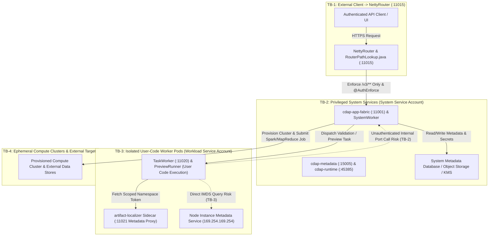

# Security Threat Model: CDAP Core Runtime (`cdapio/cdap`)

**Scope:** `https://github.com/cdapio/cdap` (branches `develop`, `release/*`)  
**Components:** `cdap-gateway`, `cdap-app-fabric`, `cdap-data-fabric`, `cdap-runtime-ext-dataproc`, `cdap-kubernetes`, `cdap-watchdog`, `cdap-security`, `cdap-common`, `cdap-etl-core`

---

## 1. Asset Definition & Scope

This threat model defines the trust boundaries, untrusted user-controlled inputs, runtime identities, known sink classes, and security invariants for the **CDAP Core Runtime** (`cdapio/cdap`).

- **Edge API Gateway (`cdap-gateway`: `NettyRouter`, `RouterPathLookup.java`, `AuthFilter`)**:
  - Terminates external HTTP/HTTPS API traffic on port `:11015`, enforces perimeter path routing (`RouterPathLookup`), authenticates requests, and dispatches `/v3/**` API calls to internal Netty services.
- **Application & Artifact Lifecycle Engine (`cdap-app-fabric`, `cdap-data-pipeline-base`)**:
  - Manages namespaces (`DefaultNamespaceAdmin`, `NamespaceHttpHandler`), artifact uploads and extraction (`ArtifactHttpHandler`, `ArtifactRepository`, `BundleJarUtil`, `FileFetcherHttpHandlerInternal`), application deployment and upgrades (`AppLifecycleHttpHandler`, `ApplicationLifecycleService`), stage and pipeline validation (`ValidationHandler`), OAuth token management (`OAuthHandler`), tethering (`TetheringHandler`), credential providers (`CredentialProviderHttpHandlerInternal`, `DefaultCredentialProviderService`), and program execution (`ProgramLifecycleHttpHandler`, `ProgramLifecycleService`, `SystemArguments`, `DistributedProgramRunner`).
- **Isolated User-Code Execution Containers (`TaskWorker`, `PreviewRunner`, `ArtifactCacheService`)**:
  - `TaskWorkerHttpHandlerInternal` (`:11020`) and `PreviewRunner` execute user-initiated design-time tasks (connector validation, schema retrieval, data preparation preview, and custom plugin `configurePipeline()`).
  - Metadata and credential sidecar handlers (`:11021`) provide scoped runtime credentials for the active namespace.
- **Data Fabric, Metadata, Watchdog & Runtime Provisioners (`cdap-data-fabric`, `cdap-watchdog`, `cdap-kubernetes`, `cdap-runtime-ext-dataproc`, `cdap-support-bundle`)**:
  - Manages datasets (`LocalDatasetTypeManager`, `DatasetInstanceHandler`), Secure Store (`SecureStoreHandler`), Kubernetes pod preparation (`KubeTwillPreparer`, `KubeTwillRunnerService`), cluster provisioners (`DataprocRuntimeJobManager`, compute profiles), logs/metrics (`LogPipelineConfigurator`, `FilterParser`), and diagnostic bundles (`SupportBundleGenerator`).

### Related Component Threat Models

- **CDAP Build & Packaging (`cdapio/cdap-build`)**: `cdap-build/THREAT_MODEL.md`
- **CDAP Web UI & Node.js Proxy (`cdapio/cdap-ui`)**: `cdap-ui/THREAT_MODEL.md`
- **CDAP Kubernetes Operator (`cdapio/cdap-operator`)**: `cdap-operator/THREAT_MODEL.md`
- **Wrangler Data Prep Service & Directives (`data-integrations/wrangler`)**: `wrangler/THREAT_MODEL.md`
- **Hydrator Core & Database Plugins (`cdapio/hydrator-plugins`)**: `hydrator-plugins/THREAT_MODEL.md`

---

## 2. Trust Boundaries & Runtime Identities

### 2.1 Trust Boundaries

- **TB-1 (External Client -> `NettyRouter` & `@AuthEnforce` RBAC Boundary)**:
  - `RouterPathLookup.java` MUST reject any external path whose normalized first segment is not `/v3/` so external callers cannot reach internal `/v3Internal/**` or `/v1/**` routes.
  - Every Netty HTTP handler method reachable under `/v3/**` MUST enforce fine-grained RBAC authorization via `@AuthEnforce` before mutating state, deleting datasets, reading secrets, or invoking `TaskWorker`.
- **TB-2 (Untrusted Worker Pods <-> Privileged System Services Boundary)**:
  - `cdap-app-fabric` (`:11001`), `cdap-metadata` (`:15005`), `cdap-runtime` (`:45385`), and `SystemWorker` run under the privileged system identity (`cdap-sa`), which holds administrative access to system storage, encryption keys, and Kubernetes API resources.
  - User-supplied code (custom `DatasetModule` jars, application upgrade hooks, or arbitrary `RunnableTask` classes) MUST NEVER execute inside `AppFabric` or `SystemWorker`.
  - Internal Netty HTTP ports (`:11001`, `:11020`, `:11021`, `:15005`, `:45385`) MUST authenticate internal callers and enforce network isolation (`NetworkPolicy` / mTLS) so compromised `TaskWorker` or `PreviewRunner` pods cannot invoke `*HttpHandlerInternal` endpoints.
- **TB-3 (`TaskWorker` / `PreviewRunner` Multi-Namespace & Metadata Credential Boundary)**:
  - `TaskWorker` and `PreviewRunner` execute user-controlled stage validation (`validateStage`), Wrangler recipes, and previews.
  - Worker pods MUST NOT query node-level instance metadata (`169.254.169.254`) directly to obtain node/cluster credentials, and MUST NOT call unauthenticated context-switching endpoints on `:11021` to forge or race another namespace's identity context.
- **TB-4 (Control/Runtime Argument Boundary -> Cluster & Kubernetes Execution)**:
  - User-supplied runtime arguments, preferences, macros, and plugin properties must not override `system.*` or `twill.security.*` arguments (`SystemArguments.java`), `cConf`/`hConf` classpath or filesystem implementations (`fs.<scheme>.impl`, `fs.gs.storage.root.url`), or inject shell commands into `DistributedProgramRunner` / `LauncherUtils`.

### 2.2 Runtime Identities

| Identity | Components | Privileges | Security Invariant |
|---|---|---|---|
| **System Service Account (`cdap-sa`)** | `cdap-app-fabric`, `cdap-router`, `cdap-metadata`, `cdap-runtime`, `cdap-system-worker`, `cdap-preview-manager` | System database, object storage, KMS secrets, and Kubernetes workload management (`pods`, `deployments`, `services`, `secrets`, `configmaps`). | **Never** execute user-supplied JARs, `DatasetModule` classes, plugin `configurePipeline()`, JEXL/Nashorn scripts, or untrusted JDBC drivers inside `cdap-sa` pods. |
| **User Workload Service Account (`cdap-user-sa`)** | `cdap-task-worker`, `cdap-preview-runner` | Scoped execution identity for design-time tasks and previews. | Block direct pod egress to `169.254.169.254`, enforce least-privilege permissions, and isolate workers by namespace identity. |
| **Per-Namespace Service Account** | Scoped credential proxy (`:11021`) -> `TaskWorker` / `PreviewRunner` | Namespace-specific least-privilege identity configured by the namespace administrator. | Bind token retrieval to an unforgeable per-task context without shared mutable singleton state. |
| **Authenticated End-User Identity** | Evaluated by `AuthFilter` and `@AuthEnforce` | Maps to CDAP RBAC roles (`Viewer`, `Developer`, `Operator`, `Admin`). | Every external `/v3/**` route must enforce `@AuthEnforce` with the required `Action` (`READ`, `WRITE`, `EXECUTE`, `ADMIN`) on the target `EntityId`. |

---

## 3. Untrusted User-Controlled Inputs & Entry Points

| Entry Point | Classes / Endpoints | Untrusted User-Controlled Inputs | Required Validation & Guards |
|---|---|---|---|
| **Edge Router (`:11015`)** | `NettyRouter`, `RouterPathLookup.java` | HTTP request URI path, query parameters, authentication headers | Canonicalize URI path first; reject any external request whose normalized path does not begin with `/v3/`. |
| **Pipeline & Stage Validation API** | `ValidationHandler.java` (`POST /v3/namespaces/{ns}/validations/stage`) | `StageValidationRequest` (plugin artifact coordinates, plugin properties, `fs.<scheme>.impl`, `fs.gs.storage.root.url`, serialized objects) | Require `@AuthEnforce` (`WRITE` / `ADMIN` on namespace); block sensitive Hadoop/cloud storage property overrides (`fs.*.impl`, `fs.gs.*`); execute only in isolated `TaskWorker`. |
| **Artifact & Dataset Module Upload APIs** | `ArtifactHttpHandler.java`, `ArtifactRepository.java`, `BundleJarUtil.java`, `LocalDatasetTypeManager.java`, `DatasetManagementService.java`, `FileFetcherHttpHandlerInternal.java` | Uploaded JAR/ZIP archives, `Artifact-Version` / `Artifact-Extends` headers, archive entry filenames (`../`, symlinks), custom `DatasetModule` classes | Enforce `@AuthEnforce`; validate archive entry canonical paths (`targetPath.normalize().startsWith(targetDir.normalize())`) and reject symlinks in `BundleJarUtil.unJar`; disable custom `DatasetModule` uploads by default (`dataset.custom.modules.enabled=false`). |
| **Internal Worker & Metadata HTTP Handlers** | `TaskWorkerHttpHandlerInternal.java` (`:11020`), `GcpMetadataHttpHandlerInternal.java` (`:11021`), `CredentialProviderHttpHandlerInternal.java` (`:11001`) | `RunnableTaskRequest` (`className`, `param`), context-setting payloads, internal `/v3Internal/**` and `/v1/**` calls | Authenticate internal callers; restrict `TaskWorkerHttpHandlerInternal` `className` to a static allowlist of system `RunnableTask` classes; eliminate unauthenticated mutable context endpoints. |
| **Namespace, OAuth, Tethering & Support Bundle Handlers** | `DefaultNamespaceAdmin.java`, `NamespaceHttpHandler.java`, `OAuthHandler.java`, `TetheringHandler.java`, `SupportBundleGenerator.java` | Namespace properties, `DELETE /v3/unrecoverable/namespaces/{ns}/datasets`, OAuth provider URLs, tethering peer endpoint URLs, support bundle `uuid` | Enforce `@AuthEnforce` on all routes; block private/link-local/IMDS IPs on outbound HTTP clients; validate `uuid` against strict UUID regex and canonical path confinement. |
| **Program Launchers, Compute Profiles & Runtime Args** | `ProgramLifecycleHttpHandler.java`, `ProgramLifecycleService.java`, `SystemArguments.java`, `DistributedProgramRunner.java`, `SparkRuntimeUtils.java`, `KubeTwillPreparer.java` | Runtime arguments (`system.*`, `twill.*`, JVM opts), compute profile properties (`token.endpoint`, `serviceAccount`), `ProfileId` | Strip/reject user-supplied `system.*` and `twill.security.*` keys; use `.equals()` instead of `==` on `ProfileId.NATIVE`; avoid shell interpolation in `LauncherUtils` / `DistributedProgramRunner`; validate `token.endpoint` in compute profiles. |

---

## 4. Known Sink Classes & Vulnerability Patterns in Scope

1. **Reflection, Dynamic ClassLoading & Arbitrary `RunnableTask` / `DatasetModule` Instantiation**:
   - **Sinks**: `TaskWorkerHttpHandlerInternal.java` (`Class.forName(request.getClassName())`), `DatasetManagementService.java` / `LocalDatasetTypeManager.java` (`DatasetModule` execution in `AppFabric`), `ApplicationLifecycleService.java` (application upgrade class instantiation in `AppFabric`), `ValidationHandler.java` (`validateStage` invoking plugin `configurePipeline()`), `SparkRuntimeUtils.java`, `LogPipelineConfigurator.java`, and `FileSetProperties.java` (`hConf` / `cConf` `Class.forName` / `getClassByName` on `fs.<scheme>.impl`).
2. **Missing `@AuthEnforce` RBAC Annotations & Internal Netty Port Exposure**:
   - **Sinks**: `RouterPathLookup.java` (fallback to `APP_FABRIC_HTTP` on non-`/v3` prefixes), `DefaultNamespaceAdmin.deleteDatasets`, `ValidationHandler.validateStage`, `OAuthHandler.java`, `TetheringHandler.java`, and all `*HttpHandlerInternal.java` classes listening on `:11001`, `:11020`, `:11021`, `:15005`, `:45385`.
3. **Path Traversal, Zip Slip & Symlink Following**:
   - **Sinks**: `BundleJarUtil.java` (`unJar`), `DirUtils.java`, `FileFetcherHttpHandlerInternal.java`, `SupportBundleGenerator.java`, and `ArtifactRepository.java`.
   - **Guard**: Verify canonical path confinement (`targetFile.getCanonicalPath().startsWith(targetDir.getCanonicalPath() + File.separator)`) and reject symbolic links (`Files.isSymbolicLink`).
4. **SSRF, Instance Metadata Service (IMDS) Access & Credential Proxy Context Forgery**:
   - **Sinks**: `GcpMetadataHttpHandlerInternal.java`, compute profile `token.endpoint`, `TetheringHandler.java`, `OAuthHandler.java`, and Hadoop `fs.gs.storage.root.url` property injection.
5. **JDBC Connection URL Injection & Unsafe Driver Parameters**:
   - **Sinks**: `JdbcUrlSanitizer.java` and JDBC plugin/service helpers in `cdap-etl-core` / `cdap-data-fabric`.
   - **Guard**: Reject dangerous driver parameters (`allowLoadLocalInfile`, `allowUrlInLocalInfile`, `autoDeserialize`, `queryInterceptors`, `statementInterceptors`, `socketFactory`, `sslfactory`, `sslpasswordcallback`, `authenticationPluginClassName`, `INIT=`, `SCRIPT`).
6. **OS Command & Shell Argument Injection**:
   - **Sinks**: `DistributedProgramRunner.java`, `LauncherUtils.java`, `SparkRuntimeUtils.java`, container launch scripts (`functions.sh`), and deprecated SSH provisioners.
7. **Unsafe Deserialization & XXE**:
   - **Sinks**: `FileFormat.READER`, `StructuredRecordStringConverter`, `ObjectInputStream` readers, and XML parsers (`DocumentBuilderFactory`, `SAXParserFactory`, `XMLInputFactory`) missing `FEATURE_SECURE_PROCESSING` and `disallow-doctype-decl`.
8. **System Argument Smuggling & Kubernetes Pod Security Standards**:
   - **Sinks**: `SystemArguments.java`, `PreviewRunnerModule.java`, `KubeTwillRunnerService.java`, `KubeTwillPreparer.java`, and `ProgramLifecycleService.java` (`ProfileId.NATIVE.equals(profileId)`).
   - **Guard**: `KubeTwillPreparer.java` MUST enforce Kubernetes Pod Security Standards `Restricted` (`allowPrivilegeEscalation(false)`, `runAsNonRoot(true)`, `seccompProfile(RuntimeDefault)`, `capabilities.drop("ALL")`).

---

## 5. Core Security Invariants

1. **Invariant CDAP-INV-01 (Strict `/v3/` Perimeter Routing & `@AuthEnforce` Coverage)**: `RouterPathLookup.java` MUST reject any external path not starting with `/v3/`. Every Netty HTTP handler method reachable under `/v3/**` MUST carry an explicit `@AuthEnforce` annotation verifying the caller's RBAC permission on the target `NamespaceId` / `InstanceId` before executing any business logic or delegating to `TaskWorker`.
2. **Invariant CDAP-INV-02 (Zero User Code Execution in `AppFabric` / System Pods)**: Custom `DatasetModule` loading (`dataset.custom.modules.enabled=false`), application upgrade hooks, plugin `configurePipeline()`, and user-supplied `Class.forName` calls MUST NEVER execute inside `cdap-app-fabric` or any pod running as `cdap-sa`.
3. **Invariant CDAP-INV-03 (Authenticated Internal Netty Services & Allowlisted `RunnableTask`)**: All internal Netty HTTP endpoints (`*HttpHandlerInternal` on `:11001`, `:11020`, `:11021`, `:15005`, `:45385`) MUST authenticate internal callers, and `TaskWorkerHttpHandlerInternal` MUST restrict `className` to a static allowlist of trusted system `RunnableTask` classes.
4. **Invariant CDAP-INV-04 (Archive Extraction Path Confinement & Immutable System Properties)**: All archive unpackers (`BundleJarUtil`, `DirUtils`, `FileFetcherHttpHandlerInternal`) MUST enforce canonical path confinement and reject symlinks, and user-supplied properties/runtime arguments MUST NOT override `fs.<scheme>.impl`, `fs.gs.storage.root.url`, `fs.gs.auth.*`, or `system.*` / `twill.security.*` keys.
5. **Invariant CDAP-INV-05 (Restricted Pod Security Standards)**: All dynamically prepared Kubernetes containers in `KubeTwillPreparer` MUST enforce `runAsNonRoot: true`, `allowPrivilegeEscalation: false`, `seccompProfile.type: RuntimeDefault`, and `capabilities.drop: ["ALL"]`.
